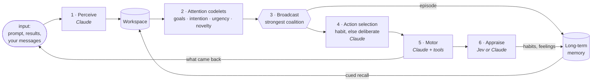

# cortex-engine

**A mind that keeps running when no one's talking to it.**

cortex-engine is a cognitive agent ("Clara") built on [LIDA](https://en.wikipedia.org/wiki/LIDA_(cognitive_architecture)),
a model of cognition based on Global Workspace Theory. A cheap attention cycle runs
ten times a second. Things compete for consciousness, the winner is broadcast, and
only then does the agent remember, decide and act. Claude is called only at the
expensive moments: making sense of new input, deliberating when no habit fits, and
carrying out an action. Everything else is local code.

She has persistent memory, her own folder of files, sandboxed Python, web access,
goals she rewrites herself, and a way to ask the person running her a question.
She judges her own actions, and the ones that work become habits. Over time she
thinks less and does more.

```
13:57:29 [broadcast via goal:ship one small tool I actually u @ 0.47]
- [percept] My goal is to ship something, but nothing has been started yet.
  · deliberating (LLM)…
→ intention: Ship one small, working tool end to end, to prove I can finish something.
  >> ACTION: Write tools/notes_index.py, a script that indexes my notes, then run it.
  << I wrote tools/notes_index.py and ran it: exit 0, 2 files listed.
  (deliberate) worked: Jev p(worked)=0.85
```

---

## The cycle



1. **Perceive.** New input is turned into a few short percepts. Each gets a
   valence and an urgency, judged against her values, her goals and what's
   already on her mind.
2. **Attend.** Attention codelets each care about one thing: one per goal, one
   for her current intention, one for urgency or strong feeling, and one for
   novelty. Each codelet seeds a coalition on the item it cares about most and
   recruits related items. Coalitions compete. Recently broadcast thoughts are
   suppressed for a while (inhibition of return), so she doesn't dwell on one.
3. **Broadcast.** The strongest coalition above threshold becomes conscious. It
   is written to episodic memory and cues related memories back into the
   workspace, so one thought can call up the next.
4. **Select an action.** A learned habit fires if one matches confidently. If
   none does, she deliberates with everything in view: conscious content, her
   intention, recent actions and how they went, values, goals, her files and
   partial habits. She chooses one action and states what she's working toward.
5. **Act.** The motor carries the action out with tools. What comes back
   re-enters through perception like any other input.
6. **Appraise and learn.** She judges whether the action worked, honestly and
   not kindly. Deliberated actions that work become habits, and every outcome
   updates a habit's reliability. Outcomes also return as feelings with graded
   valence.

When nothing has broken through for a while, **her mind wanders**. It returns to
what she's working on, then to each goal, then to whether her goals still fit.
Wandering pulls related memories in, so an input-less mind keeps going without
any LLM calls.

## What she can do

| Ability | How |
|---|---|
| **Remember** | Episodic, declarative and procedural memory in [mem0](https://github.com/mem0ai/mem0), plus a reliability count for each habit. Repeats reinforce existing memories instead of piling up copies. |
| **Search and read the web** | Anthropic-hosted `web_search` / `web_fetch` |
| **Keep files** | Her own `workspace/` folder: list, read, write, edit, delete. Paths can't escape it, and there are size quotas. |
| **Run Python** | `run_python`, jailed to her folder (see [Sandbox](#sandbox)) |
| **Rewrite her goals** | `revise_goals`: add, retire, reword. Every change is logged with her reason. |
| **Ask you something** | `ask_<name>`: the question prints in your terminal. She doesn't wait; your reply arrives later as input. |
| **Hold an intention** | One sentence she's working toward across actions. It survives restarts and has its own attention codelet. |

## Values and goals

- **Values** (`values.txt`) are who she is. They're shown to her when she
  perceives, deliberates and appraises, but they're fixed and never "done".
- **Goals** (`goals.txt` is only the seed) are concrete things she's pursuing.
  Each goal gets an attention codelet, so goals decide what reaches her. She
  revises them herself, and from then on `lida_goals.json` takes over.

A **goal check** fires when she finishes or drops an intention, and every 30
minutes. She sees how much attention each goal actually won, and either changes
the goals or says on the record why they still fit.

## Sandbox

Python she writes runs under [bubblewrap](https://github.com/containers/bubblewrap)
with every namespace unshared:

- She sees only her `workspace/` folder (as `/workspace`), plus a read-only `/usr`.
  Nothing else from your home directory, no `.env`, no keys, no host environment
  variables.
- **No network** by default. Opt in with `LIDA_EXEC_NETWORK=1`.
- 30 s wall clock, 512 MB of memory, and a cap on process count. These are
  cgroup limits via `systemd-run --user` when available, with rlimits otherwise.
  The whole process group is killed on timeout.
- If `bwrap` isn't installed, code execution is switched off. There is no
  unsandboxed fallback.

## Quick start

Needs Python 3.11–3.13, [Poetry](https://python-poetry.org/), an Anthropic API
key, and optionally `bwrap` (Debian/Ubuntu: `apt install bubblewrap`).

```sh
git clone https://github.com/BangRocket/cortex-engine
cd cortex-engine
poetry install                 # CPU-only torch; the embedding model runs locally
cp .env.example .env           # set ANTHROPIC_API_KEY
poetry run python lida-llm.py
```

She runs until Ctrl-C. **Type a line and press Enter to talk to her.** The first
line after one of her questions is taken as your answer. Log lines are colored by
source: Claude, Jev, memory, the cycle, actions, conversation, errors.

To start over:

```sh
poetry run python reset_memory.py           # memory, goals, intention; keeps her files
poetry run python reset_memory.py --files   # ...and her workspace folder too
```

## Configuration

Every setting lives in `.env` and is documented in [`.env.example`](.env.example).
The ones you're most likely to change:

| Setting | Default | |
|---|---|---|
| `LIDA_LLM_MODEL` | `claude-sonnet-5-5` | Model for perception, deliberation and actions |
| `LIDA_ACTION_INTERVAL` | `30` | Minimum seconds between actions; this paces spend |
| `LIDA_IDLE_SECONDS` | `10` | Quiet seconds before her mind wanders |
| `LIDA_DECIDER` | `llm` | `jev` to appraise with TypeSafe's Jev (Claude as fallback) |
| `LIDA_GOAL_REVIEW_MINUTES` | `30` | Timer for goal checks (`0` = only when an intention ends) |
| `LIDA_USER_NAME` | `Joshua` | Who she can ask; also names the tool |
| `LIDA_WEB` / `LIDA_FILES` / `LIDA_EXEC` / `LIDA_ASK` | `1` | Turn abilities off individually |
| `LIDA_EXEC_NETWORK` | `0` | Network access for her Python |
| `LIDA_VERBOSE` / `LIDA_COLOR` | `1` / `auto` | Step-by-step logging; colored output |

## Files

| Path | |
|---|---|
| `lida-llm.py` | The whole agent: cycle, memory, tools, sandbox, main loop |
| `personalities/clara.txt` | Who she is; the system prompt for every call |
| `prompt.txt` | Her first input on startup |
| `values.txt` · `goals.txt` | Fixed values · seed goals |
| `reset_memory.py` | Clears memory and state |

Created at runtime and gitignored: `lida_qdrant/` (vectors), `lida_history.db`,
`lida_mem0/`, `scheme_stats.json` (habit reliability), `lida_goals.json` and
`lida_goals_log.jsonl`, `lida_intention.json`, and `workspace/`.

## Cost and limits

- An action costs a few Claude calls (deliberation, motor with tools, appraisal),
  and new input costs a perception call. Facts are consolidated every 10
  broadcasts. Habits replace deliberation over time. `LIDA_ACTION_INTERVAL` is
  the main lever on spend.
- Embeddings use local `bge-small-en-v1.5` on CPU. Similarity thresholds are
  calibrated for that model; re-measure them if you change it.
- It's an experiment, not a product. Expect to tune thresholds, and expect her to
  get stuck in ways that teach you something about the architecture.
